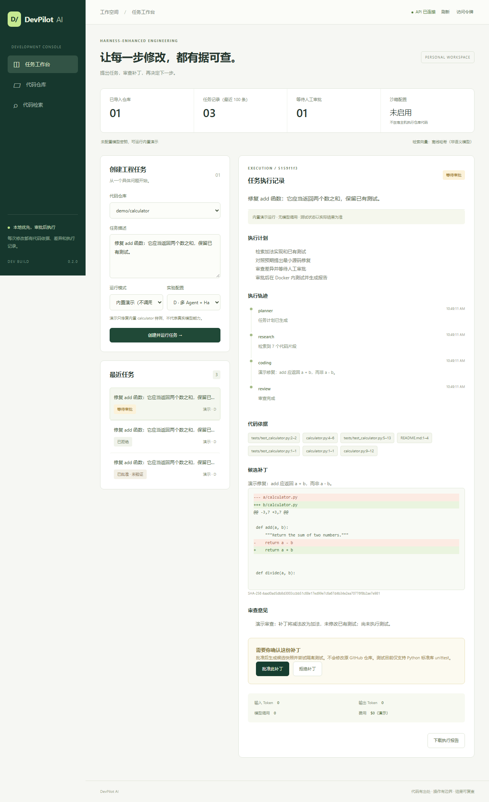

# DevPilot AI

**A Harness-Enhanced Multi-Agent Coding Platform**

基于 LangChain、LangGraph 和 Agent Harness 的软件工程协作工作台。导入代码快照，描述任务，查看引用与候选补丁，经人工审批后尝试隔离测试，最后导出 Diff、源码快照与执行报告。

当前版本 **0.2.0**，面向单用户本地使用与求职演示。默认无需 API Key 即可跑通内置样例；真实模型、外部向量服务、队列与容器部署均通过独立配置接入。**固定演示补丁不代表大模型能力，未实际执行的测试不会显示为通过。**



## 已实现的闭环

- GitHub REST 导入固定 commit 的受限文本快照，过滤路径、大小、symlink、二进制与常见秘密文件。
- Tree-sitter 解析 Python / JS / TS / TSX，其他文本行分块；引用保留路径、行号和 commit。
- BM25、Qdrant 向量检索、RRF 混合与轻量路径重排；可切换真实 Embedding。
- LangGraph 控制规划、检索、编码、审查、审批、测试和报告；支持持久化暂停与失败节点恢复。
- LangChain 结构化模型输出；D 配置在 Coding 节点集成 Deep Agents 与只读工具、虚拟文件系统。
- 补丁精确匹配、SHA-256 审批绑定、模型调用与上下文限制、Docker 固定 unittest 执行器，无宿主机执行回退。
- SQLite 本地模式、PostgreSQL Checkpoint/业务数据、Redis/RQ 后台任务配置。
- React / TypeScript / Tailwind 工作台：文件查看、检索、任务轨迹、Diff、批准/拒绝、报告与 ZIP 下载。
- MCP stdio 只读工具、可复现离线 smoke 评测、Windows/Linux 测试、浏览器验收与 Compose 配置。

原 GitHub 仓库不会被任务修改。当前交付是审核后导出补丁/候选源码，自动创建 PR 属于后续独立授权的功能。测试执行器目前只支持 Python 标准库 unittest 仓库，不自动安装外部依赖，也不执行模型生成的任意 Shell。

## 技术栈与模式

| 层 | 默认本地模式 | 可配置集成 |
| --- | --- | --- |
| API / UI | FastAPI、Pydantic、React、Vite、TypeScript、Tailwind | Nginx 同源网关 |
| Agent | LangGraph + 固定 demo provider | LangChain ChatOpenAI、Deep Agents |
| RAG | Tree-sitter、BM25、Qdrant 内存模式、离线哈希向量 | OpenAIEmbeddings、Qdrant 服务 |
| 持久化 | SQLAlchemy / SQLite + SQLite Checkpoint | PostgreSQL + PostgreSQL Checkpoint |
| 执行 | 本地线程后台任务，不执行仓库代码 | Redis / RQ、Docker Sandbox |
| 观测 / 测试 | 持久化事件、Token callback、Pytest、Ruff、Playwright | LangSmith（自行启用） |

默认哈希向量是词项哈希，不是语义 Embedding。费用未配置价格时保留 null。项目未宣称具备动态 Skill 发现、长期自学习记忆、通用安全执行或多租户生产能力。架构边界与取舍见 [ARCHITECTURE.md](docs/ARCHITECTURE.md)。

## 快速启动：Windows + VS Code

已检查环境：Python 3.12.4、Git 2.45.2、Node.js 22.22.0、npm.cmd 10.9.4。Docker 未在本机找到，uv 不是必需项。首次安装需要联网；使用 Python 3.12.x 和 Node 22.12+（本项目实测 22.22.0）。

以下均为 PowerShell 命令，每条成功后再运行下一条。本工作区已安装依赖，若你继续使用当前机器，可直接跳到启动服务。

### 1. 首次安装

进入项目根目录，预期提示符定位到此项目；其他电脑替换为实际检出路径：

```powershell
Set-Location 'C:\Users\86180\Desktop\DevPilot AI'
```

在根目录检查 Python，预期输出 3.12.x：

```powershell
python --version
```

在根目录创建虚拟环境，预期生成 `.venv/Scripts/python.exe`。它隔离依赖，不隔离恶意代码：

```powershell
python -m venv .venv
```

在根目录安装锁定第三方依赖，预期安装到项目 `.venv`，不修改全局 Anaconda 包：

```powershell
.\.venv\Scripts\python.exe -m pip install -r backend/requirements.lock --index-url https://pypi.org/simple
```

在根目录注册可编辑后端，预期显示 devpilot-backend 0.2.0 安装成功。`--no-deps` 保持锁文件中的版本：

```powershell
.\.venv\Scripts\python.exe -m pip install --no-deps -e './backend[dev]' --index-url https://pypi.org/simple
```

进入前端目录，预期当前目录变为 frontend：

```powershell
Set-Location frontend
```

在 frontend 按锁文件安装前端包，预期生成 node_modules。`npm.cmd` 不触发被 PowerShell 禁止的 npm.ps1，不需要修改系统执行策略：

```powershell
npm.cmd ci --offline=false --registry=https://registry.npmjs.org --cache=../.npm-cache
```

### 2. 启动后端

新建 VS Code 终端，在项目根目录进入 backend，预期工作目录切换成功：

```powershell
Set-Location backend
```

在 backend 启动 ASGI 服务，预期监听 8000；`--reload` 让源码变更后重载，Ctrl+C 停止：

```powershell
..\.venv\Scripts\python.exe -m uvicorn app.main:app --reload --host 127.0.0.1 --port 8000
```

- 健康检查：<http://127.0.0.1:8000/api/v1/health>
- API 文档：<http://127.0.0.1:8000/docs>

### 3. 启动前端

第二个 VS Code 终端从根目录进入 frontend，预期工作目录切换成功：

```powershell
Set-Location frontend
```

在 frontend 启动 Vite，预期显示 5173；Ctrl+C 停止：

```powershell
npm.cmd run dev
```

打开 <http://127.0.0.1:5173>。浏览器的 `/api` 由 Vite 转发到 8000，不需要通配 CORS。两端可独立启动，后端不可用时页面显示错误与刷新入口。

### 4. 体验一次完整任务

1. 点击“导入演示仓库”，查看 calculator.py 的加法错误。
2. 用默认任务与 demo 模式运行，观察计划、引用、Diff 与执行轨迹。
3. 点击“拒绝补丁”，确认无法下载候选快照。
4. 新建任务后批准，下载 ZIP，检查 Diff、source/ 与 report.json。
5. 当前未启用 Docker 时，正确结果是 **已批准 · 未验证 / not_run**；不会伪造绿色测试。

真实模型密钥只写在本机根目录 `.env`。前端“访问令牌”输入框用于工作台 Bearer Token，不能填模型 API Key。配置、Compose、Docker 和 MCP 见 [部署指南](docs/DEPLOYMENT.md)。

## 测试与验证

以下后端命令都在 backend 目录，无需启动服务器。

检查依赖，预期无冲突：

```powershell
..\.venv\Scripts\python.exe -m pip check
```

运行单元、工作流、脚本模型契约与 MCP stdio 测试；当前本地预期 46 passed、2 skipped。跳过项需要实际 Docker/基础设施，不能当成通过：

```powershell
..\.venv\Scripts\python.exe -m pytest -q
```

代码静态检查，预期 All checks passed：

```powershell
..\.venv\Scripts\python.exe -m ruff check app tests
```

格式检查，预期无需修改：

```powershell
..\.venv\Scripts\python.exe -m ruff format --check app tests
```

以下命令在 frontend 目录。

类型检查和生产构建，预期生成 dist：

```powershell
npm.cmd run build
```

首次安装测试浏览器，预期下载 Playwright Chromium；不影响个人浏览器：

```powershell
npm.cmd exec -- playwright install chromium
```

运行浏览器验收，预期 3 项通过；自动启动测试用后端与前端，数据位于独立的 `.data/e2e`：

```powershell
npm.cmd run test:e2e
```

测试时不要占用相同端口。真实服务测试、运行证据和远程 CI 状态见 [VALIDATION.md](docs/VALIDATION.md)。

## 评测：先有原始记录，再谈效果

在 backend 运行下列命令，预期输出 benchmarks/results/smoke.json。`--approve` 仅自动批准脚本中的自有演示样例，不会修改外部仓库：

```powershell
..\.venv\Scripts\python.exe -m app.benchmark --approve
```

包含六个检索查询和一个刻意植入错误的样例，实际比较三种检索与 A/B/C/D 流程。它用于验证评测代码，不足以证明多 Agent 优于单 Agent。无实际测试时成功率为 null；恢复率、人工介入率未测量时同样为 null。原始本地结果的审查副本见 [smoke-results.json](docs/smoke-results.json)。扩展方法见 [benchmarks](benchmarks/README.md)。

## 学习与后续工程化

- [从使用到理解：学习指南](docs/LEARNING_GUIDE.md)
- [架构与设计取舍](docs/ARCHITECTURE.md)
- [环境与部署说明](docs/DEPLOYMENT.md)
- [原始目标、路线与实际完成矩阵](docs/PROJECT_PLAN.md)
- [后续协作约定](AGENTS.md)

尚需真实服务验收的部分会明确记录，不能把 SDK 契约测试当作真实模型成功。后续重点是更多真实任务、多轮补丁修复、通用测试适配器、数据库迁移、索引增量优化、学习型 reranker 和更强执行隔离，而不是增加空壳 Agent 名称。

MIT License。
