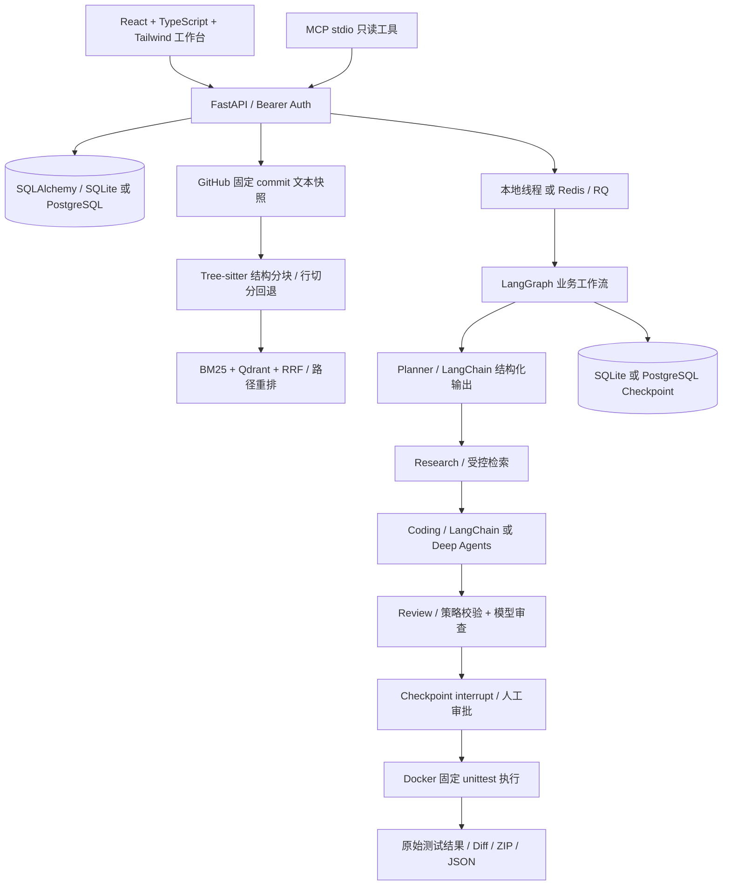

# 技术架构与取舍

## 请求与执行路径

## 文件职责

- `backend/app/core/`：配置、密钥字段、URL 与路径边界。
- `storage.py`：业务快照、任务、事件和决策；`service.py`：用例与事务边界。
- `repositories.py`：GitHub REST 导入和内置演示；不会 clone 或执行 setup.py。
- `rag/`：结构分块、BM25、向量索引、RRF 和证据引用。
- `agents/models.py`：模型适配、角色技能、只读工具、模型调用与 Token 计数。
- `agents/workflow.py`：唯一顶层图；A/B 使用单次编码，C/D 使用规划/检索/编码/审查。
- `harness/`：精确文本替换校验、摘要绑定、隔离命令构造与执行预算。
- `api/`：HTTP 契约；`worker.py`：RQ 消费；`mcp_server.py`：只读 MCP 接口。
- `frontend/src/`：真实 API 工作台；`frontend/e2e/`：浏览器验收。

## 为何这样组合

LangGraph 管理持久化、流程路由和审批，Deep Agents 仅作为 D 配置的 Coding 节点内部能力。没有自研第二个推理循环。编码工具只能读取本次任务的不可变快照；Deep Agents 的 StateBackend 是虚拟文件系统，未提供宿主机 Shell 或本地磁盘 Backend。Planner、Research、Coding、Review 的输出、权限与状态各不相同；Research 当前使用确定性检索工具，不额外调用模型重写问题。

替代方案是一个 Deep Agent 负责全部任务，或用 CrewAI/AutoGen 统一调度。当前选择 LangGraph 是为了直接表达审批和重启恢复；代价是需要维护节点状态契约。项目未直接复制上述框架实现。

角色技能是随包发布的 Markdown 提示资源，通过 `RoleModels` 加载。未宣称实现 Deep Agents 内置的动态 Skill 发现、异步子代理调度或长期自学习记忆。D 模式启用了其编码 Agent/规划和虚拟文件系统能力；顶层各角色仍由 LangGraph 协作。

## 数据与一致性

仓库导入固定到 commit，任务始终读取该快照。重新导入相同 commit 复用记录，新 commit 创建新快照。文件按语言、大小、路径与权限模式过滤，不支持 symlink/submodule/二进制导入；最多 150 个文件、每文件 50 KB、累计 2 MB，并有导入时间预算。`stats.partial` 告知是否仅导入部分内容。

短期状态存在 LangGraph，任务事件和结果存在 SQLAlchemy，长期代码知识存在快照/索引。索引可从不可变 chunks 重建。没有把这三者都叫作“记忆”。当前没有全局自学习记忆或跨任务模型训练。

补丁只支持已有源文件的唯一精确文本替换。保护测试与配置，检查 commit 和 SHA-256。审批后在内存构造候选文件，导出到 ZIP；原快照、用户工作区和 GitHub 原仓库都不会被修改。PR 创建保留为未来单独授权的功能。

任务用数据库条件更新认领，重复投递不重复执行。Checkpoint 使失败节点能够恢复；已经完成的规划节点不必重跑。默认线程模式适合一个本地 API 进程；容器部署使用 RQ。

## RAG 的真实含义

Python/JS/TS/TSX 使用 Tree-sitter 顶层语法边界，过长块再按 60 行切分；解析失败或其他文本格式回退行分块。每块保留原路径、起止行、commit 与稳定 ID。

默认 hash 是离线词项哈希向量，不是预训练语义 Embedding。可用服务端设置切换至 LangChain OpenAIEmbeddings。默认 Qdrant 内存实例便于运行，Compose 使用独立 Qdrant 服务。关键词使用 BM25，混合使用 Reciprocal Rank Fusion，最后给路径词项匹配加权；这是确定性轻量重排，不是 Cross-Encoder。

当前每个查询必要时重建向量索引，适用于小型作品仓库；大规模增量索引、任务专用 reranker、Embedding 批次成本控制仍需进一步工程化。

## 预算与可观测性

模型请求超时、SDK 重试上限、单次输出上限、最多 12 次模型调用、图递归上限、只读工具次数/字符上限和上下文裁剪共同约束运行。Token 阈值按模型返回用量在请求间检查，属于软预算，单次请求可能跨过阈值，不宣称硬 Token 计费限额。

Usage callback 记录模型返回的输入/输出 Token；未配置单价时 API 费用为 null。错误只存异常类别，不向 UI 输出可能含凭据的 provider 原始异常。可选择开启自己的 LangSmith tracing；开启前确认代码和提示允许发送到该项目。

执行轨迹持久化，但 UI 使用轮询，没有声称实现 SSE 逐 Token 流。当前是单用户可信工作台，不提供多租户隔离、RBAC 或公共 SaaS SLA。
